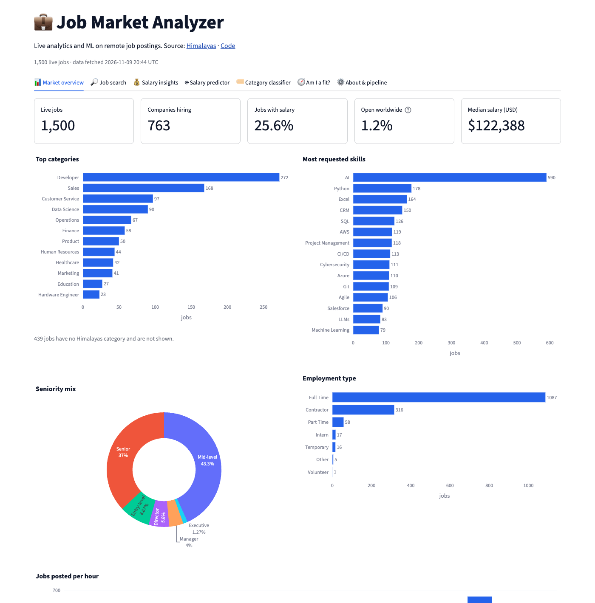
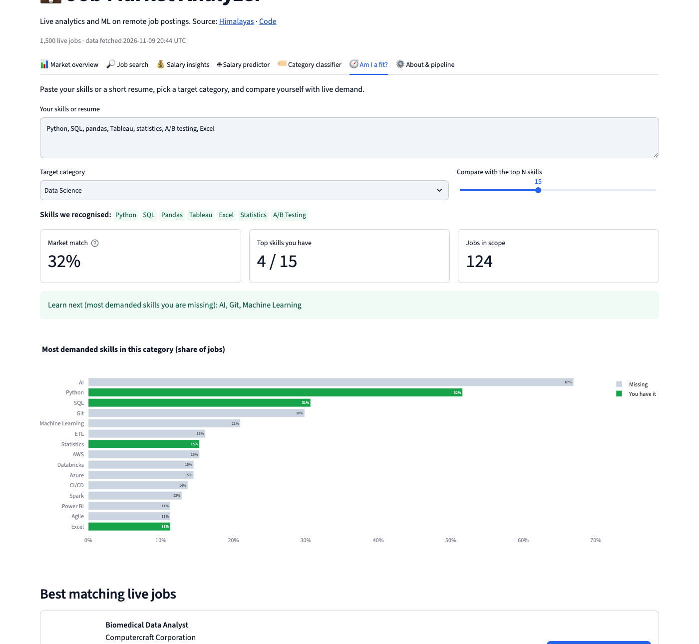
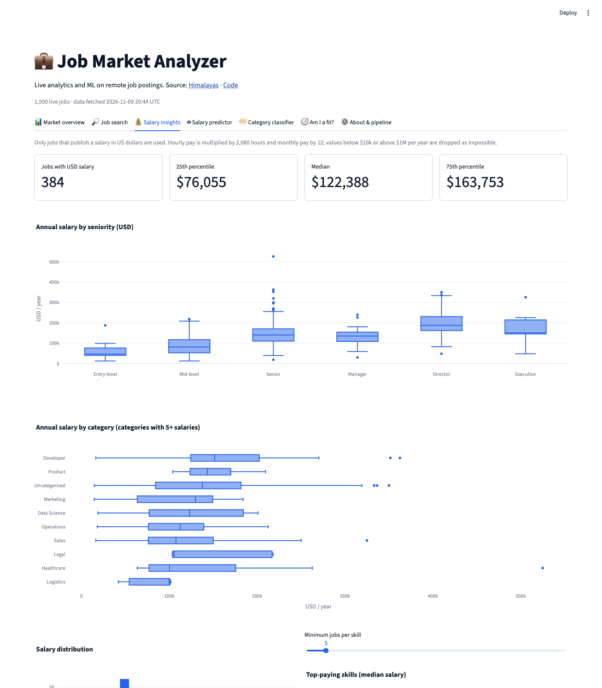
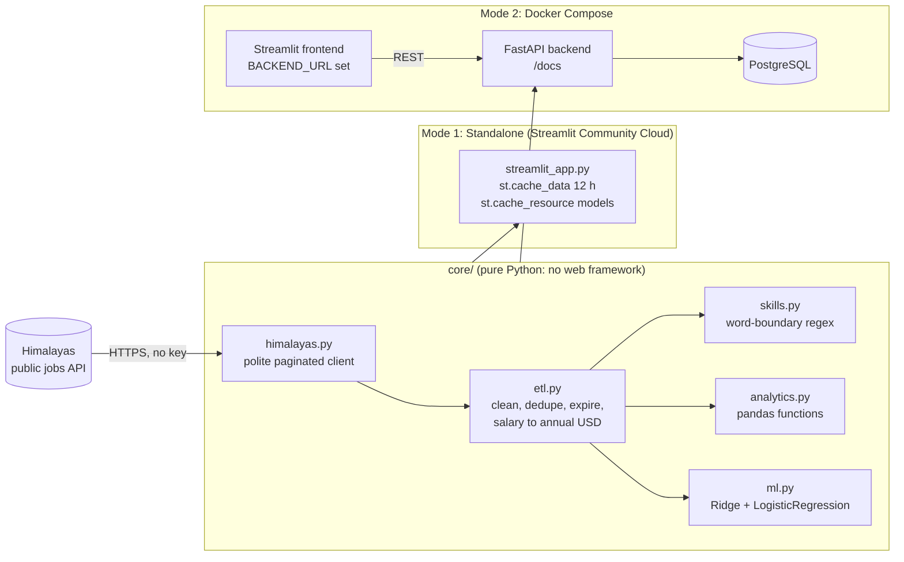

# 💼 Job Market Analyzer

[](https://github.com/Gunar-Oguz/job_analyzer/actions/workflows/ci.yml)


Live analytics and machine learning on about 1,500 of the newest remote job postings.
It shows what the market asks for, what it pays, and how well your own skills fit.
It runs as a one-click demo with **no API keys and no cloud account**, and as a
full **FastAPI + PostgreSQL + Docker** stack.

### [▶ Open the live app](https://job-analyzer-gulnar.streamlit.app)

The first visit takes about a minute, because the app downloads fresh jobs and trains its models.
After that, the data is cached for 12 hours.

---

## Screenshots

| Market overview | Am I a fit? | Salary insights |
|---|---|---|
|  |  |  |

## Features

| Tab | What it does |
|---|---|
| 📊 **Market overview** | Live jobs, companies hiring, share of jobs with a salary, share open worldwide, median salary. Top categories, most requested skills, seniority mix, employment types, and a posting timeline. |
| 🔎 **Job search** | Keyword search plus filters for category, seniority, employment type, country, minimum salary and "has salary". Results as cards (company logo, salary range, location rules, skills, posted time) or as a table. Every **Apply** button uses the original application link unchanged, next to a "via Himalayas" link. |
| 💰 **Salary insights** | p25, median and p75 of annual USD salary. Box plots by seniority and by category, a histogram, and the top-paying skills (median salary of jobs that mention a skill, with a minimum-count slider). |
| 🤖 **Salary predictor** | Title, seniority, category, location, employment type and skills give a predicted yearly salary with a typical range. The tab shows test MAE, R², a naive baseline and 5-fold CV, so you can judge the model yourself. |
| 🏷️ **Category classifier** | A title (and an optional description) gives the top 3 categories with probabilities. The tab shows held-out accuracy, top-3 accuracy, macro F1 and the majority baseline. |
| 🧭 **Am I a fit?** | Paste a skill list or a short resume and pick a target category. You get a demand-weighted match score, the most demanded skills marked as *have* or *missing*, a "learn next" list, and the best matching live jobs. |
| ⚙️ **About & pipeline** | Data freshness, fetch statistics, how many rows each cleaning rule removed, model metrics and the architecture. |

## Architecture

The same pure-Python core powers two ways of running the app.



* **Standalone mode** (no `BACKEND_URL`): the Streamlit app fetches jobs at runtime,
  keeps the DataFrame in memory and trains both models in-process. This is what the live demo runs.
* **API mode** (`BACKEND_URL` set): the frontend reads jobs from the FastAPI service and asks it for
  predictions. The backend upserts jobs into PostgreSQL with parametrised SQL, deletes expired jobs,
  and retrains the models after every `POST /refresh`.

### API endpoints

Interactive docs are at `http://localhost:8000/docs`.

| Method | Path | Purpose |
|---|---|---|
| GET | `/health` | Status, number of jobs, store type, model readiness |
| POST | `/refresh?max_pages=50` | Fetch from Himalayas, clean, upsert, retrain |
| GET | `/pipeline` | Last fetch report and cleaning counts |
| GET | `/jobs` | Search with `q`, `category`, `seniority`, `employment_type`, `location`, `min_salary`, `has_salary`, `limit`, `offset` |
| GET | `/jobs/{id}` | One job with its cleaned description |
| GET | `/stats/overview`, `/skills/top`, `/salaries/summary`, `/salaries/top-skills` | Analytics |
| POST | `/fit` | Skill gap and best matching jobs for a skill list |
| GET | `/ml/metrics` | Held-out metrics of both models |
| POST | `/ml/predict-salary`, `/ml/classify` | Predictions |

## Run it

**Standalone (the same as the live demo):**

```bash
python -m venv .venv && source .venv/bin/activate
pip install -r requirements.txt
streamlit run streamlit_app.py
```

**Full stack (PostgreSQL + FastAPI + Streamlit):**

```bash
docker compose -f docker/docker-compose.yml up --build
# UI:  http://localhost:8501    API docs: http://localhost:8000/docs
```

On first start the backend sees an empty database and fetches 1,000 jobs in the background
(`REFRESH_ON_STARTUP`). You can also press **Refresh data from Himalayas** in the sidebar, or call `POST /refresh`.

**Deploy on Streamlit Community Cloud:** choose this repository, branch `main`,
main file `streamlit_app.py`, and Python 3.12 under *Advanced settings*. No secrets are needed.

## Data source and terms

Jobs come from the public [Himalayas](https://himalayas.app) jobs API. It needs no key, and every page shows
**Source: Himalayas** with a link. The app follows the API terms:

* Every **Apply** button uses the job's `applicationLink` **unchanged**.
* Jobs are shown only inside this app. **No job data is stored in this repository.** The data is fetched
  at runtime, and `.gitignore` blocks data files. The tests use a small **synthetic** feed
  (`tests/synthetic.py`) with made-up companies on `example.com`.
* Expired jobs (`expiryDate` in the past) are removed during cleaning and again when loading from the database.
* The client is polite. It sends a descriptive `User-Agent`, waits 0.5 s between requests, retries with
  capped exponential backoff (1, 2, 4 s, at most 30 s), stops at an overall time limit of 75 s, and keeps
  what it already downloaded if a later page fails. It only raises an error if nothing was downloaded.

## Machine learning

Both models are trained **at startup on the data just fetched**. Training takes a few seconds,
and `random_state=42` keeps it reproducible. No `.pkl` files are committed.

| Model | Features | Algorithm | Target |
|---|---|---|---|
| Salary | TF-IDF of the title (1–2 grams), one-hot seniority / category / country / employment type, multi-hot skills | Ridge (α = 5, chosen by 5-fold CV) | log(annual USD salary) |
| Category | TF-IDF of the title and of the excerpt + description | Logistic regression | main Himalayas category (classes with at least 8 jobs) |

**Measured on 2026-11-09** from one local run: 1,500 jobs fetched, of which 384 had a usable USD salary
and 1,048 had a category with enough examples. The test split is a random 20%.

| Salary model | Value |
|---|---|
| Training / test rows | 307 / 77 |
| Test MAE | **$44,623** (baseline "always predict the median": $53,116) |
| 5-fold CV MAE | **$36,210** |
| R² on log salary (test) | 0.38 |
| R² in dollars: test / 5-fold CV | 0.04 / 0.36 |

| Category model (17 classes) | Value |
|---|---|
| Training / test rows | 838 / 210 |
| Accuracy | **77.6%** (majority-class baseline: 26.2%) |
| Top-3 accuracy | 91.9% |
| Prediction is one of the job's categories | 84.3% |
| Macro F1 | 0.67 |

Honest notes:

* **The numbers change every day**, because the data changes and the models are retrained.
  The app always shows the metrics of the model it is actually using.
* A single 77-row test split is noisy. In this run, a few very high salaries in the test split pushed
  the dollar R² close to zero, while 5-fold CV gave 0.36. That is why the app shows both.
* A posting does not tell us the company's pay band, equity or exact city. So the predictor gives a
  rough guide with a range (the 10th–90th percentile of held-out errors), not a precise number.
* Many jobs belong to several categories. Strict top-1 accuracy is therefore a lower bound.

## Tests

```bash
pip install -r requirements-dev.txt
ruff check . && ruff format --check .
pytest
```

There are **67 tests, and none of them touch the network.** An autouse fixture makes any real HTTP call fail the test.

| File | Covers |
|---|---|
| `test_skills.py` | Word boundaries ("r" in "for", "ai" in "maintain", R&D, "go further", "react to"), C++ / C# / Node.js, parsing a user's skill list |
| `test_etl.py` | HTML cleaning, salary normalisation (hourly, monthly, non-USD, out of range, swapped min/max), duplicates, expiry, record round trip |
| `test_himalayas.py` | Fake session: `nextCursor` pagination, User-Agent, pause, retries with backoff, partial failure keeps data, total failure raises, time limit |
| `test_analytics.py` | Overview, counts, timeline, every search filter, salary percentiles, top-paying skills, skill gap, best matches |
| `test_ml.py` | Deterministic training, the model beats the baseline, prediction range, classifier top-3, "not enough data" handling |
| `test_api.py` | Every FastAPI endpoint via `TestClient` with an in-memory store and a fake loader, plus validation errors |
| `test_app.py` | Streamlit `AppTest` in standalone mode with a synthetic feed: every tab renders, filters work, and the API-down message appears |

## CI/CD

`.github/workflows/ci.yml`:

1. **Lint and test** on Python 3.11 and 3.14 for every push and pull request (ruff + pytest).
2. **Docker images** for backend and frontend. They are built on pull requests, and on `main` they are pushed
   to Docker Hub with the `latest` and commit-SHA tags (secrets `DOCKER_USERNAME` / `DOCKER_PASSWORD`).
3. **Optional AWS deploy** (ECR + EC2 over SSH). It only runs when the repository variable `AWS_DEPLOY` is
   `true`, so it is off by default.

The Docker images use `python:3.12-slim`, run as a non-root user, have a `HEALTHCHECK`, and copy
only the code they need (see `.dockerignore`).

## Design decisions and trade-offs

* **A keyless data source.** The first version used Adzuna, which needs API keys. A portfolio demo should
  work for anyone with one click, so the app now uses the public Himalayas API. The cost is a smaller,
  remote-only sample (the newest ~1,500 jobs), which is stated in the UI.
* **No committed data.** The API terms do not allow redistribution, so data is fetched at runtime and only
  synthetic fixtures live in git. This also keeps the demo fresh.
* **Train at startup, not from pickles.** Pickled models go stale and can break when library versions change.
  Training on the current data takes seconds, and it keeps the metrics honest for the data on screen.
* **Word-boundary skill matching.** A plain `"r" in text` check finds "R" in almost every job.
  The skill dictionary uses token boundaries, and for short or ambiguous names ("R", "Go", "AI", "Excel",
  "React", "REST") it only accepts the exact capitalisation and, for "Go", a list-like context.
* **Salary normalisation.** Only USD salaries are used, because guessing exchange rates would add silent error.
  Hourly pay is ×2,080 and monthly pay ×12. Values outside $10k–$1M per year are dropped, because the feed
  contains clearly mislabelled periods (for example a monthly wage tagged as annual).
* **One core, two shells.** All logic lives in `core/` as small pure functions with no Streamlit or FastAPI
  imports. The backend and the UI are thin layers, which makes the core easy to test.
* **Postgres arrays for list fields.** Skills, categories and locations are stored as `TEXT[]` and upserted
  in batches with `ON CONFLICT`, so repeated refreshes stay cheap.

## What I learned

* How to design a data client that is polite to a shared public API, and how to test retries,
  partial failure and time limits with an injected fake session and clock.
* How easily text matching produces false positives, and how to protect it with tests.
* Why a model should be reported against a naive baseline and with cross-validation, and how much
  a small test split can mislead.
* How to keep one codebase usable as a free hosted demo and as a containerised service with a database.

## Project structure

```
job_analyzer/
├── streamlit_app.py          # Streamlit Cloud entry point (standalone mode)
├── requirements.txt          # what the standalone app needs
├── requirements-dev.txt      # + FastAPI, pytest, ruff
├── pyproject.toml            # ruff and pytest settings
├── core/                     # pure Python, no web framework
│   ├── himalayas.py          # API client: cursor pagination, retries, time limit
│   ├── etl.py                # cleaning rules and report
│   ├── skills.py             # skill dictionary + word-boundary extraction
│   ├── analytics.py          # pandas functions for every chart and table
│   ├── ml.py                 # salary regression and category classifier
│   └── pipeline.py           # fetch + clean in one call
├── frontend/
│   ├── app.py                # the Streamlit UI (both modes)
│   └── api_client.py         # HTTP client for API mode
├── backend/
│   ├── main.py               # FastAPI app (lifespan, endpoints)
│   ├── storage.py            # PostgreSQL and in-memory stores
│   └── requirements.txt
├── docker/                   # Dockerfiles and docker-compose.yml
├── tests/                    # 67 tests + synthetic fixture
├── docs/                     # screenshots
└── .github/workflows/ci.yml
```

---

**Gulnar Albushova**, UC Berkeley Master of Information and Data Science (MIDS) · [LinkedIn](https://www.linkedin.com/in/gulnar-albushova-253252140/) · [GitHub](https://github.com/Gunar-Oguz)
